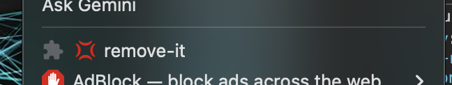

# remove-it chrome extension
Basic extension that removes target elements that you simply dont want to see.
This is a recreation of an existing extension called "Fuck it" that was removed from the chrome store.

## Features
- Auto-deletes from history visited pages containing banned terms.

## Installation
1. Clone this repo OR Go to release, download the zip, and unzip it.
2. Go to `brave://extensions` or `chrome://extensions`
3. Turn on **Developer mode** on the top right.
4. Click **Load unpacked** and select the folder containing this repo

## Tech
- JavaScript
- Chrome Extensions API (Manifest V3)